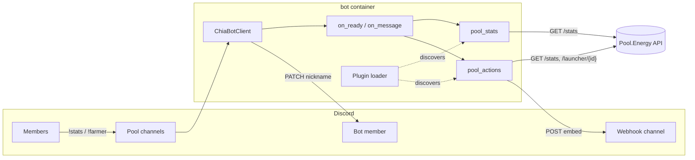

# Pool.Energy — Bot

[](https://github.com/Pool-Energy/bot/actions/workflows/build-and-publish.yml)
[](https://www.python.org)
[](https://discordpy.readthedocs.io)
[](LICENSE)

The Discord bot for **Pool.Energy**, a Chia farming pool. It keeps a pool
Discord server in sync with live pool data: it rotates the bot nickname through
the main pool metrics and answers `!stats` / `!farmer` commands with rich embeds
posted through a Discord webhook.

It is a small, plugin-based Python service: a `discord.py` client dispatches
events to plugins discovered at startup, and each plugin talks to the
Pool.Energy REST API.



---

## Table of contents

- [Tech stack](#tech-stack)
- [Features](#features)
- [Getting started](#getting-started)
- [Project structure](#project-structure)
- [Architecture](#architecture)
- [Configuration](#configuration)
- [Pool.Energy API contract](#poolenergy-api-contract)
- [Docker image](#docker-image)
- [Continuous integration](#continuous-integration)
- [Troubleshooting](#troubleshooting)
- [Contributing](#contributing)
- [License](#license)

## Tech stack

| Concern        | Choice                                                                 |
| -------------- | ---------------------------------------------------------------------- |
| Language       | Python 3.11+ (`datetime.UTC`, `asyncio`)                               |
| Discord        | `discord.py` 2.7 (`discord.Client`, intents, member renames)           |
| HTTP           | `aiohttp` (async REST calls, webhook posts)                            |
| Configuration  | YAML (`pyyaml`), loaded from a mounted file                            |
| Logging        | `colorlog` with a coloured console formatter                           |
| Formatting     | `humanize` (pool/netspace sizes in the nickname)                       |
| Chia dependency| `chia-blockchain` fork pinned to `release/2.7.5` (see `requirements.txt`) |
| Packaging      | Docker (`debian:bookworm-slim` + virtualenv)                           |
| CI/CD          | GitHub Actions → `ghcr.io/pool-energy/bot`, signed with cosign         |
| License        | AGPL-3.0                                                               |

## Features

- **Live pool nickname** (`pool_stats` plugin): every `interval` seconds the bot
  renames itself in the configured guild, cycling through 7 metrics — active
  farmers, pool size, netspace, blockchain height, XCH price, dust storm status
  and pool effort — so the member list doubles as a status board.
- **`!stats`** (`pool_actions` plugin): posts an embed with pool size (PiB),
  active farmers, XCH price (USD/EUR), average effort and the sync state of the
  pool and fee wallets.
- **`!farmer <launcher_id>`**: posts an embed for a single launcher — name,
  online state, launcher id, PPLNS points, difficulty, farmed blocks, harvesters,
  partials and estimated size, with the farmer avatar as thumbnail. An optional
  `0x` prefix is stripped before the API call.
- **`!help` / `!commands`**: replies with the command list.
- **Pluggable by design**: every `PluginBase` subclass dropped in
  `chiabot/plugins/` is discovered automatically and can be enabled or disabled
  per deployment (`-p` / `PLUGIN_LIST`).

## Getting started

### Requirements

- **Python 3.11+** (the container uses Debian bookworm's 3.11)
- A **Discord application** with a bot token, and the *Server Members* and
  *Message Content* privileged intents enabled in the developer portal
- A **Discord webhook** for the channel where embeds are posted
- Network access to `https://pool.energy/api/v1.0`

### Install

```bash
python3 -m venv venv
./venv/bin/pip install -r requirements.txt
```

### Configure

```bash
cp config-sample.yaml config.yaml
$EDITOR config.yaml
```

At minimum set `discord.token`, `discord.guild` and `pool_actions.webhook`.
`config.yaml` is git-ignored: never commit real tokens or webhook URLs.

### Run

```bash
./venv/bin/python -m chiabot.main -c config.yaml -p pool_stats pool_actions
```

| Flag                | Required | Description                                     |
| ------------------- | -------- | ----------------------------------------------- |
| `-c`, `--config`    | yes      | Path to the YAML configuration file             |
| `-p`, `--plugin`    | no       | Plugin names to load (all discovered if omitted) |

### Docker

```bash
docker build -t pool-energy-bot .

docker run --rm \
  -v "$(pwd)/config.yaml:/data/bot/config.yaml:ro" \
  -e PLUGIN_LIST="pool_stats pool_actions" \
  pool-energy-bot
```

## Project structure

```
bot/
├── .github/
│   ├── dependabot.yml              # Daily github-actions/pip/docker updates
│   └── workflows/
│       ├── build-and-publish.yml   # Docker build, GHCR push, cosign signing
│       └── labels.yml              # Repository label sync
├── chiabot/
│   ├── __init__.py
│   ├── main.py                     # CLI entry point: logging, config, bootstrap
│   ├── client.py                   # discord.Client subclass dispatching events
│   ├── plugin.py                   # PluginBase + plugin discovery/dispatch
│   └── plugins/
│       ├── pool_actions.py         # !stats, !farmer, !help commands
│       └── pool_stats.py           # Nickname rotation loop
├── docker/entrypoint.sh            # venv python -m chiabot.main with env vars
├── Dockerfile                      # Debian bookworm + virtualenv
├── config-sample.yaml              # Documented configuration template
├── requirements.txt                # Pinned Python dependencies
└── README.md
```

## Architecture

### Bootstrap

`chiabot/main.py` is the only entry point:

1. Parses `-c/--config` (required) and `-p/--plugin` (`nargs='+'`).
2. Configures `logging` through `logging.config.dictConfig` with a
   `colorlog.ColoredFormatter` (`[timestamp] (LEVEL) module.function():line - msg`).
3. Loads the YAML file with `yaml.safe_load`.
4. Builds `Plugins(config, includes=args.plugin or None)`.
5. Creates `ChiaBotClient` with the default intents plus `members` and
   `message_content`, then calls `client.run(config['discord']['token'])`.

### Plugin system

`chiabot/plugin.py` implements a very small plugin framework:

- `PluginBase` exposes a `NAME` (defaults to the file name when not set) and
  stores the whole configuration in `self.config`.
- `Plugins.__load_plugins()` iterates over `chiabot/plugins/*.py`, loads each
  file with `SourceFileLoader`, and registers the **first** `PluginBase`
  subclass found in the module. The class name itself is irrelevant — the file
  name becomes the plugin name.
- `Plugins.exec_plugin(client, name, ...)` calls the hook `name` on every plugin
  that implements it and **isolates failures**: an exception is logged with
  `exc_info=True` and the remaining plugins still run.

Supported hooks:

| Hook                       | Trigger                          | Arguments              |
| -------------------------- | -------------------------------- | ---------------------- |
| `on_ready(client)`         | Discord client connected         | `client`               |
| `on_message(client, msg)`  | Any message not sent by the bot  | `client`, `message`    |

Adding a plugin therefore means: create `chiabot/plugins/<name>.py`, subclass
`PluginBase`, implement `on_ready` / `on_message`, and add `<name>` to the
`-p` flag or `PLUGIN_LIST`.

### Event dispatch

`ChiaBotClient` (in `chiabot/client.py`) subclasses `discord.Client` and only
does two things: log the login and forward `on_ready` / `on_message` to the
plugin registry, ignoring messages authored by the bot itself.

### `pool_stats` (nickname rotation)

`on_ready()` schedules an infinite `asyncio` loop. Every
`pool_stats.interval` seconds it fetches `/stats`, resolves the guild and the
bot's member object, and edits the nickname using `i % 7` to pick the metric:

| `i % 7` | Nickname                                        |
| ------- | ----------------------------------------------- |
| 0       | `Farmers: <farmers_active>`                     |
| 1       | `Pool size: <humanized pool_space>`             |
| 2       | `Netspace: <humanized blockchain_space>`        |
| 3       | `Height: <blockchain_height>`                   |
| 4       | `Price: $<xch_current_price.usd>`               |
| 5       | `Dust Storm: yes\|no`                           |
| 6       | `Pool effort: <average_effort>%`                |

Errors are caught per iteration, so a failing API call never stops the loop.

### `pool_actions` (commands)

`on_message()` inspects the raw message content (prefix commands, no command
framework) and posts embeds with `aiohttp` to `pool_actions.webhook`. Embeds are
sent through the webhook rather than `message.channel.send`, so the reply
always lands in the webhook's channel.

## Configuration

`config-sample.yaml` documents every key:

| Key                   | Type   | Description                                                        |
| --------------------- | ------ | ------------------------------------------------------------------ |
| `global.baseapi`      | string | Pool.Energy API root, e.g. `https://pool.energy/api/v1.0`          |
| `pool_stats.interval` | int    | Seconds between nickname updates (default `30`)                    |
| `discord.token`       | string | Bot token (privileged: keep out of git)                            |
| `discord.guild`       | string | Guild (server) id used to rename the bot                           |
| `pool_actions.channel`| string | Channel id reserved for commands in the sample config              |
| `pool_actions.webhook`| string | Discord webhook URL used to post command embeds                    |

> **Note** — the command filter reads `pool_actions.channel_id`, while the
> sample config ships `pool_actions.channel`. With the shipped sample the filter
> is therefore inactive and commands are accepted in every channel the bot can
> read. Use `channel_id` if you need to restrict it, and make sure the webhook
> itself points at the same channel.

## Pool.Energy API contract

All calls are `GET` requests against `global.baseapi`:

| Endpoint                     | Used by                 | Fields consumed                                                                 |
| ---------------------------- | ----------------------- | ------------------------------------------------------------------------------- |
| `/stats`                     | `pool_stats`, `!stats`  | `farmers_active`, `pool_space`, `blockchain_space`, `blockchain_height`, `xch_current_price.usd/eur`, `blockchain_duststorm`, `average_effort`, `pool_wallets[].synced` |
| `/launcher/{launcher_id}/`   | `!farmer`               | `name`, `is_pool_member`, `launcher_id`, `points_pplns`, `difficulty`, `blocks.total`, `partials.harvesters`, `partials.total`, `estimated_size`, `picture_url` |

Command embeds are `POST`ed to the Discord webhook with
`username: "Pool.Energy Bot"`, `color: 2522040`, a *Powered by pool.energy*
footer and an ISO timestamp.

## Docker image

`Dockerfile` builds a single stage on `debian:bookworm-slim`:

1. Installs `python3-venv`, `python3-yaml`, `python3-aiohttp`, `python3-dev`,
   `gcc`, `git` and networking tools.
2. Creates `/root/bot/venv` and installs `requirements.txt` there (this includes
   the `chia-blockchain` fork pinned to `release/2.7.5`).
3. Copies `chiabot/` and `docker/entrypoint.sh`.

`docker/entrypoint.sh` runs:

```bash
./venv/bin/python -m chiabot.main \
  -p ${PLUGIN_LIST:-""} \
  -c ${CONFIG_FILE:-/data/bot/config.yaml}
```

| Variable      | Default                 | Description                                        |
| ------------- | ----------------------- | -------------------------------------------------- |
| `PLUGIN_LIST` | *(empty)*               | Space-separated plugin names passed to `-p`        |
| `CONFIG_FILE` | `/data/bot/config.yaml` | Configuration path, typically a mounted volume     |

The image exposes `8088` (reserved, nothing listens on it today) and stops the
Python process through `trap "killall python" TERM`.

> **Important** — leave `PLUGIN_LIST` unset and the entrypoint passes an empty
> `-p ""`, which matches no plugin and starts an idle client. Always set it
> explicitly in production.

## Continuous integration

`.github/workflows/build-and-publish.yml` runs on pushes to `main`, `stable/*`,
`feature/*`, `bugfix/*`, `hotfix/*` and `v*.*.*` tags, and on pull requests
targeting those branches.

1. Checkout, QEMU and Buildx setup.
2. Install cosign.
3. Login to GHCR (skipped for pull requests).
4. Docker metadata (commit SHA, branch, `vX.Y.Z`, `vX.Y`, `vX`, `latest`).
5. `docker/build-push-action` for `linux/amd64` with `no-cache: true`, pushing
   to `ghcr.io/pool-energy/bot` unless the event is a pull request.
6. Keyless cosign signature of the pushed digest (skipped for pull requests).

There is no unit test suite: the workflow validates the image build, which is
also the only place `requirements.txt` is resolved.

## Troubleshooting

| Symptom                                             | Fix                                                                                       |
| --------------------------------------------------- | ----------------------------------------------------------------------------------------- |
| `discord.LoginFailure: Improper token has been passed` | Check `discord.token` (and that it was not revoked)                                     |
| `PrivilegedIntentsRequired`                          | Enable *Server Members* and *Message Content* in the Discord developer portal              |
| Nickname never changes                               | Check `discord.guild`, that the bot can change its own nickname (`MANAGE_NICKNAMES`), and the logs for `/stats` failures |
| Commands are ignored                                 | The bot needs the *Message Content* intent and read access to the channel                  |
| `!stats` posts nowhere                               | Invalid or revoked `pool_actions.webhook`; the channel filter does not apply (see above)   |
| `!farmer` returns nothing                            | The API returned 404 — verify the launcher id (hex, `0x` prefix optional)                  |
| Container starts but does nothing                    | `PLUGIN_LIST` is empty: pass `pool_stats pool_actions`                                     |
| `Failed to run on_message for Plugin<...>`           | The stack trace is logged by `exec_plugin`, one plugin failing does not stop the others    |

## Contributing

Commits follow [Conventional Commits](https://www.conventionalcommits.org/)
(`feat|fix|docs|refactor|test|chore(scope): summary`, English only). Work on a
`<type>/<short-description>` branch and open a pull request against `main`.

## License

Distributed under the **GNU Affero General Public License v3.0** — see
[LICENSE](LICENSE).
